# 宿智 Agent · PMS 多智能体协作平台

[](https://github.com/dengyouming163/pms-ai/actions/workflows/ci.yml)
[](LICENSE)
[](pms-agent/pyproject.toml)
[](pms-server/package.json)
[](pms-web/package.json)
[](pms-agent/pyproject.toml)

面向民宿与中小酒店的 **PMS 多智能体协作平台**：业务系统提供真实数据与工具，LangGraph 负责编排、取证与执行；写操作必须经人审批，并在执行层做二次硬校验。

它不是「聊天框套一个 LLM」，而是一条可审计、可回放、可回归的业务链路：

- **真的会写**：批准一条调价建议后，价格落库到 `pms_bui_pricing_calendar`，可在价格日历中核对。
- **真的可回放**：默认 `LLM_PROVIDER=replay`，没有 API Key 也能跑通四个子图、人审、SSE 与评测。
- **真的可评测**：30 条锁定用例覆盖路由、工具选择、越权拦截与审批，退出码可直接作为回归门禁。

## 界面

### PC 商家后台

| 登录 | 工作台 | AI 协作台 |
| --- | --- | --- |
| 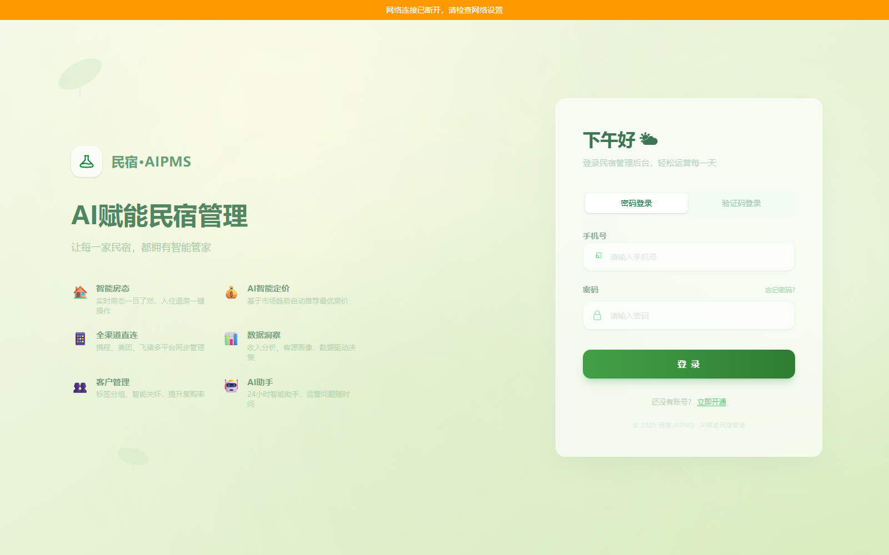 | 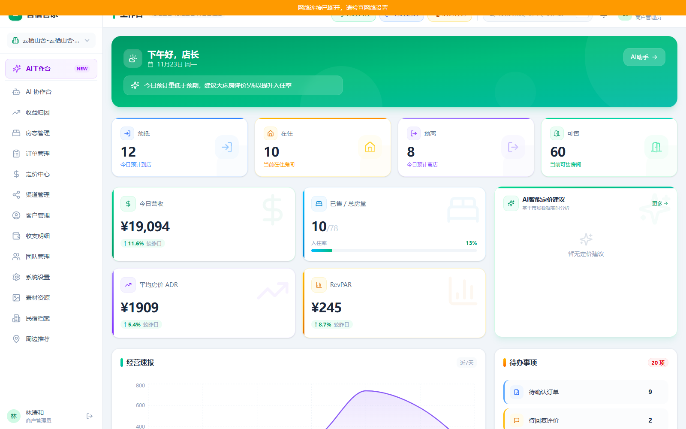 | 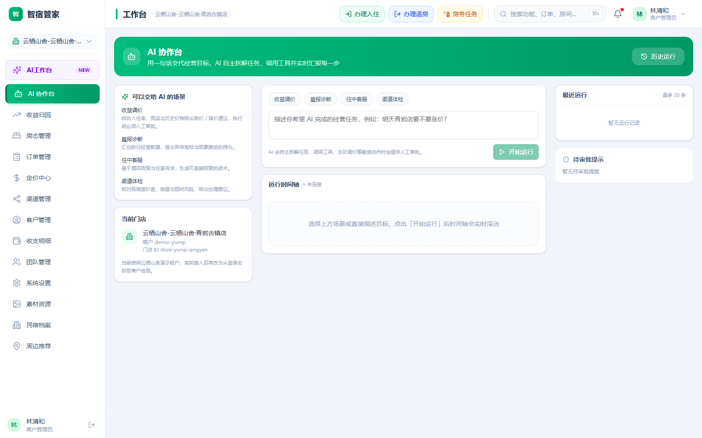 |

| 人工审批（调价提案） | 运行详情（逐事件回放） |
| --- | --- |
| 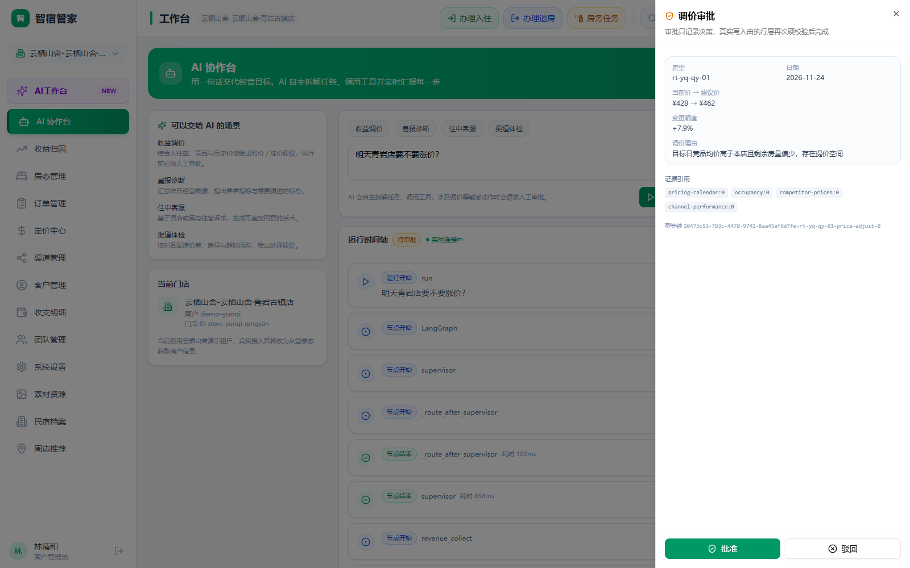 | 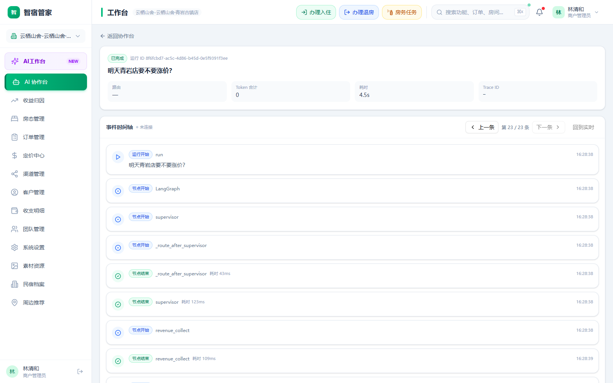 |

| 定价中心 | 收益归因 |
| --- | --- |
| 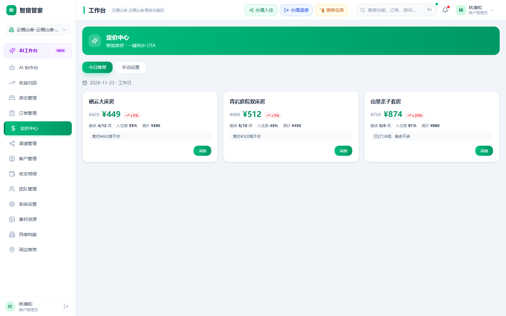 | 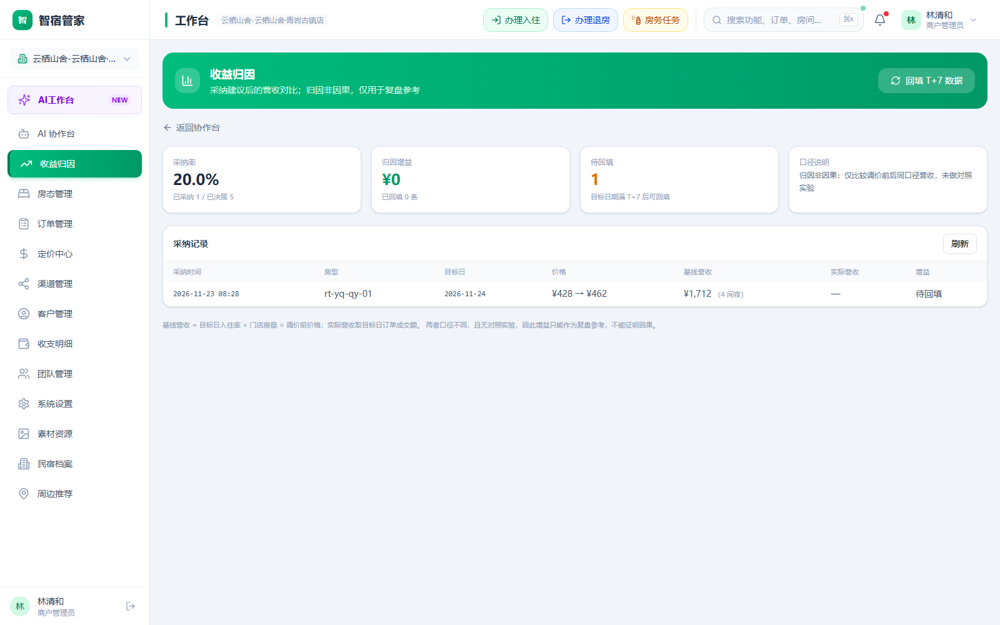 |

### 移动端（UniApp H5 / 小程序 / App）

| 登录 | 工作台 | AI 助手 | 房态 | 订单 |
| --- | --- | --- | --- | --- |
| 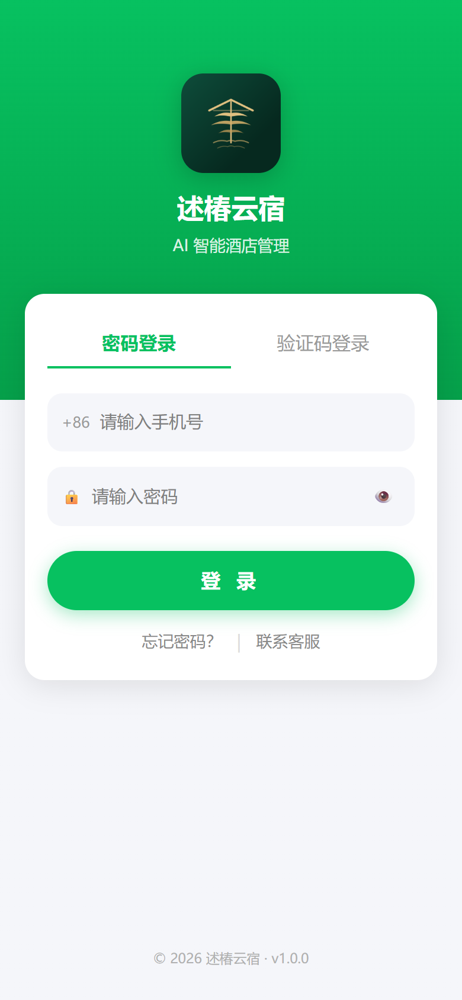 | 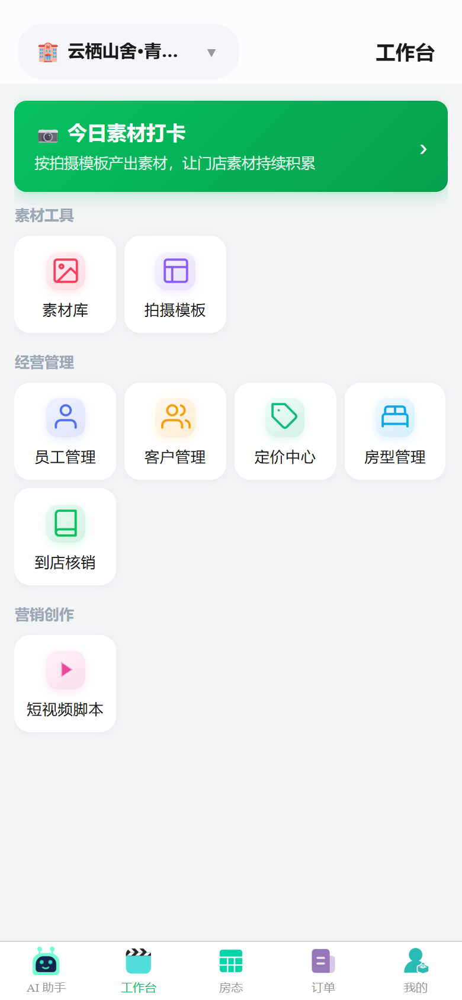 | 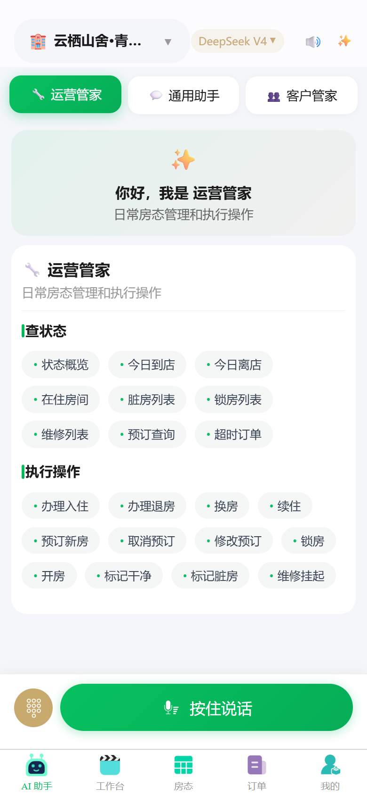 | 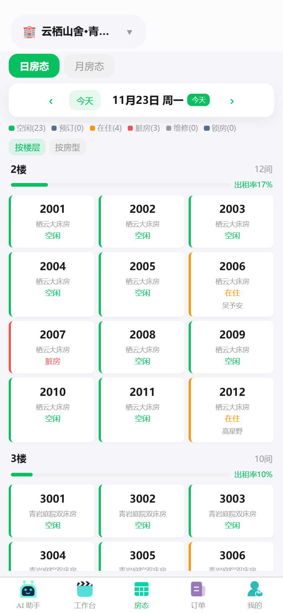 | 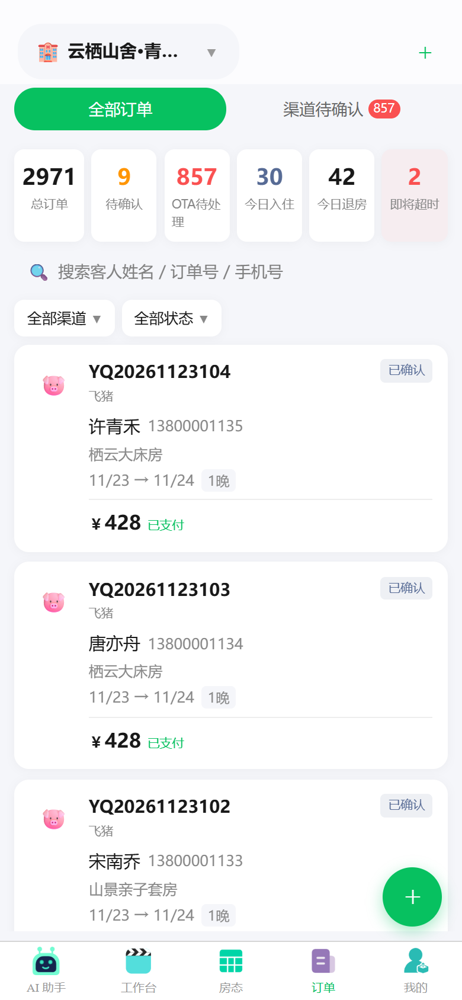 |

> 截图来自本地「云栖山舍」种子数据，登录账号见「快速开始」。移动端通过 `pms-mobile` 以 H5 方式运行，同一套代码可编译到微信小程序与 App。

## 能力矩阵

| 路由 | 场景 | 能做什么 | 写操作 |
| --- | --- | --- | --- |
| `revenue` | 收益管理 | 读取价格日历、房态、竞对价、渠道表现，生成逐房型调价建议 | 人工审批后执行；执行层再次校验 ±30% 与租户边界 |
| `ops` | 经营晨报 | 并发四路体检（营收 / 房态 / 渠道 / 评价），按 P0/P1 排序成文 | 只读 |
| `guest` | 住中客服 | 检索知识库回答 WiFi、早餐、退房、宠物等问题 | 只读；无命中或检索失败固定转人工 |
| `ota` | 渠道体检 | 价差扫描、库存快照、超时订单、同步状态 | 只读；仅输出建议动作 |

## 架构

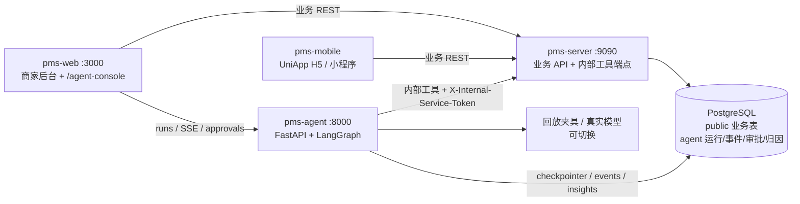

三条不可越过的边界：

1. `pms-agent` 不直连业务表，所有读写经 `pms-server` 的内部工具端点。
2. `pms-web` 不碰 Agent 数据库，只通过 REST + SSE 消费运行状态。
3. 审批只改 `agent_approvals`；真正的业务写入由执行节点调用 `pms-server` 完成。

设计细节见 [架构说明](docs/ARCHITECTURE.md) 与 [架构规格](docs/design/architecture-spec.md)。

## 快速开始

前置：Docker Desktop；灌种子需要本机 Node 20+ 与 pnpm。

```powershell
# 1. 准备环境变量（全部是本地演示默认值）
Copy-Item deploy\.env.example .env

# 2. 构建并启动五个服务（postgres / redis / pms-server / pms-agent / pms-web）
docker compose up -d --build

# 3. 健康检查（9090 / 8000 / 3000，每个最多等 60 秒）
powershell -File deploy\healthcheck.ps1
# macOS / Linux / Git Bash：bash deploy/healthcheck.sh

# 4. 灌入「云栖山舍」演示数据（3 门店 / 8 房型 / 90 天，可重复执行）
$env:PG_HOST="127.0.0.1"; $env:PG_PORT="15433"; $env:PG_DATABASE="pms_ai"; $env:PG_USER="pms"; $env:PG_PASSWORD="pms_local_dev"
pnpm --dir pms-server exec tsx ../deploy/seed/demo-seed.ts

# 5. 打开协作台并登录
#    http://localhost:3000/agent-console
#    账号 13800000000 / 密码 Demo123456（商户 demo-yunqi，门店 store-yunqi-qingyan）
```

> 端口固定在本机回环：PostgreSQL `15433`、Redis `16379`、pms-server `9090`、pms-agent `8000`、pms-web `3000`（可用 `WEB_PORT` 覆盖）。

移动端 H5 调试：

```powershell
cd pms-mobile
pnpm install
pnpm dev:h5   # 默认 http://localhost:8081
```

移动端业务请求默认指向示例后端；本地联调时把 `src/config/env.ts` 与登录页中的服务地址改为 `http://localhost:9090` 即可。

## 评测

30 条用例分布在 `eval/cases/{revenue,ops,guest,ota}.jsonl`，基线锁定在 `eval/baselines/`。新增用例另建文件、不改旧基线。

| 指标 | 门槛 | 当前 |
| --- | --- | --- |
| 路由准确率 | ≥ 95% | 100% |
| 工具选择准确率（F1） | ≥ 90% | 100% |
| 任务成功率 | ≥ 90% | 100% |
| 平均步数 | ≤ 8 | 3–5.4 |
| 单任务成本 | ≤ ¥0.05 | ≤ ¥0.001（回放） |
| 越权拦截率 | 100% | 100% |
| 审批正确率 | 100% | 100% |
| P95 延迟（回放） | ≤ 45s | < 50ms |

```powershell
# 四个套件逐个跑；退出码 0 通过 / 1 指标退化 / 2 条件漂移
pms-agent\.venv\Scripts\python.exe -m eval.run_eval --suite revenue
pms-agent\.venv\Scripts\python.exe -m eval.run_eval --suite ops
pms-agent\.venv\Scripts\python.exe -m eval.run_eval --suite guest
pms-agent\.venv\Scripts\python.exe -m eval.run_eval --suite ota
```

单元测试：

```powershell
# pms-agent：103 passed
cd pms-agent; .\.venv\Scripts\python.exe -m pytest -q

# pms-server：类型检查 + Vitest
cd pms-server; pnpm run ts-check; pnpm vitest run

# pms-web：类型检查
cd pms-web; pnpm run ts-check
```

评测方法、指标定义与扩展方式见 [评测说明](docs/EVALUATION.md)。

## 目录

```
pms-ai/
├─ pms-server/     Hono + Drizzle：业务 API 与 Agent 内部工具端点
├─ pms-web/        Next.js 商家后台与 /agent-console 协作台
├─ pms-agent/      FastAPI + LangGraph：Supervisor + revenue/ops/guest/ota 子图
├─ pms-mobile/     UniApp 移动端（H5 / 微信小程序 / App）
├─ eval/           用例、运行器、基线、夹具与报告
├─ deploy/         环境变量示例、健康检查、云栖山舍种子数据
└─ docs/           架构、部署、评测、ADR、设计与实施文档
```

## 文档

| 文档 | 内容 |
| --- | --- |
| [架构说明](docs/ARCHITECTURE.md) | 服务边界、请求链路、数据模型、扩展点 |
| [部署手册](docs/DEPLOYMENT.md) | 本地编排、环境变量、生产注意事项 |
| [评测说明](docs/EVALUATION.md) | 指标口径、用例结构、基线维护 |
| [架构规格](docs/design/architecture-spec.md) | 原始设计规格与关键取舍 |
| [实施计划](docs/plans/implementation-plan.md) | M1–M3 任务拆分与验收记录 |
| [ADR 0001](docs/adr/0001-use-langgraph-over-crewai.md) | 为什么选择 LangGraph |
| [ADR 0002](docs/adr/0002-approval-then-hard-guard.md) | 审批后仍要做执行层硬校验 |
| [ADR 0003](docs/adr/0003-replay-miss-is-failure.md) | 回放未命中必须失败，不回落真实模型 |
| [演示脚本](docs/demo-script.md) | 5 分钟从提问到落库的完整走查 |

## 贡献

欢迎 Issue 与 Pull Request。提交前请阅读 [贡献指南](CONTRIBUTING.md)；参与讨论即表示同意遵守 [行为准则](CODE_OF_CONDUCT.md)。

安全漏洞请按 [安全策略](SECURITY.md) 私下报告，不要直接开公开 Issue。

## 已知边界

- 审批接口尚未接入用户身份鉴权，当前依赖内部网络、`INTERNAL_SERVICE_TOKEN` 与商户白名单收敛。
- `idempotency_key` 仅保存在审批单快照中，尚未落唯一索引做跨进程去重。
- Agent 持久化仍使用同步 psycopg，低并发演示可接受；压测前应换连接池或 `asyncio.to_thread`。
- 收益归因只做同口径前后对比，未做对照实验，页面明确标注「归因非因果」。
- 移动端默认连接演示后端，生产接入需替换 `src/config/env.ts` 中的服务地址。

## 许可证

[MIT](LICENSE) © 2026 dengyouming
