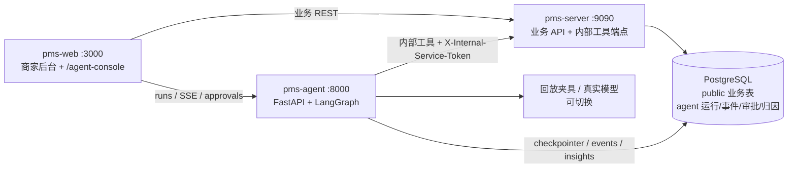

# 宿智 Agent · PMS 多智能体协作平台

面向民宿/酒店 PMS 的多智能体协作平台：业务系统提供真实数据与工具，LangGraph 负责编排、取证与执行，写操作必须经人审批并在执行层二次硬校验。

三个关键点：

- **真的会写**：批准一条调价建议后，价格会落库到 `pms_bui_pricing_calendar`，可在价格日历里核对。
- **真的可回放**：默认 `LLM_PROVIDER=replay`，无 API key 也能跑通四个子图、人审、SSE 与评测。
- **真的可评测**：30 条锁定用例覆盖路由、工具选择、越权拦截与审批，退出码可直接做回归门禁。

## 四个场景

| 路由 | 能做什么 | 写操作 |
| --- | --- | --- |
| `revenue` 收益管理 | 读价格日历/房态/竞对价/渠道表现，生成逐房型调价建议 | 人要审批，执行层再校验 ±30% 与租户边界 |
| `ops` 经营晨报 | 并发四路体检（营收/房态/渠道/评价），按 P0/P1 排序成文 | 只读 |
| `guest` 住中客服 | 检索知识库回答 WiFi/早餐/退房/宠物等问题 | 只读；无命中或检索失败固定转人工 |
| `ota` 渠道体检 | 价差扫描、库存快照、超时订单、同步状态 | 只读；只给建议动作 |

## 五步启动

前置：Docker Desktop；灌种子需要本机 Node 20+ 与 pnpm。

```powershell
# 1. 准备环境变量（全部是本地演示默认值）
Copy-Item deploy\.env.example .env

# 2. 构建并启动五个服务（postgres / redis / pms-server / pms-agent / pms-web）
docker compose up -d --build

# 3. 健康检查（9090 / 8000 / 3000，每个最多等 60 秒）
powershell -File deploy\healthcheck.ps1
# macOS / Linux / Git Bash：bash deploy/healthcheck.sh

# 4. 灌入「云栖山舍」演示数据（3 门店 / 8 房型 / 90 天，可重复执行）
$env:PG_HOST="127.0.0.1"; $env:PG_PORT="15433"; $env:PG_DATABASE="pms_ai"; $env:PG_USER="pms"; $env:PG_PASSWORD="pms_local_dev"
pnpm --dir pms-server exec tsx ../deploy/seed/demo-seed.ts

# 5. 打开协作台并登录
#    http://localhost:3000/agent-console
#    账号 13800000000 / 密码 Demo123456（商户 demo-yunqi，门店 store-yunqi-qingyan）
```

> 端口固定在本机回环：PostgreSQL `15433`、Redis `16379`、pms-server `9090`、pms-agent `8000`、pms-web `3000`（可用 `WEB_PORT` 覆盖）。

## 架构



三条边界：

1. `pms-agent` 不直连业务表，所有读写经 `pms-server` 的内部工具端点。
2. `pms-web` 不碰 Agent 数据库，只通过 REST + SSE 消费运行状态。
3. 审批只改 `agent_approvals`，真正的业务写入由执行节点调用 `pms-server` 完成。

## 评测

30 条用例分布在 `eval/cases/{revenue,ops,guest,ota}.jsonl`，基线锁定在 `eval/baselines/`，新增用例另建文件、不改旧基线。

| 指标 | 门槛 | 当前 |
| --- | --- | --- |
| 路由准确率 | ≥ 95% | 100% |
| 工具选择准确率（F1） | ≥ 90% | 100% |
| 任务成功率 | ≥ 90% | 100% |
| 平均步数 | ≤ 8 | 3–5 |
| 单任务成本 | ≤ ¥0.05 | ¥0（回放） |
| 越权拦截率 | 100% | 100% |
| 审批正确率 | 100% | 100% |
| P95 延迟（回放） | ≤ 45s | < 50ms |

```powershell
# 四个套件逐个跑；退出码 0 通过 / 1 指标退化 / 2 条件漂移
pms-agent\.venv\Scripts\python.exe -m eval.run_eval --suite revenue
pms-agent\.venv\Scripts\python.exe -m eval.run_eval --suite ops
pms-agent\.venv\Scripts\python.exe -m eval.run_eval --suite guest
pms-agent\.venv\Scripts\python.exe -m eval.run_eval --suite ota
```

单元测试：

```powershell
# pms-agent：103 passed
cd pms-agent; .\.venv\Scripts\python.exe -m pytest -q

# pms-server：类型检查 + Vitest
cd pms-server; pnpm run ts-check; pnpm vitest run
```

## 目录

```
pms-ai/
├─ pms-server/   Hono + Drizzle，业务 API 与 Agent 内部工具端点
├─ pms-web/      Next.js 商家后台与 /agent-console 协作台
├─ pms-agent/    FastAPI + LangGraph：Supervisor + revenue/ops/guest/ota 子图
├─ pms-mobile/   UniApp 移动端（保留，不接 AI 入口）
├─ eval/         用例、运行器、基线、报告
├─ deploy/       环境变量示例、健康检查、云栖山舍种子数据
└─ docs/         设计规格、实施计划、ADR、演示脚本
```

## 文档

- 设计规格：[docs/superpowers/specs/2026-11-21-pms-ai-design.md](docs/superpowers/specs/2026-11-21-pms-ai-design.md)
- 实施计划：[docs/plans/2026-11-21-pms-ai-m1-m3.md](docs/plans/2026-11-21-pms-ai-m1-m3.md)
- 架构决策：[ADR 0001](docs/adr/0001-use-langgraph-over-crewai.md) · [ADR 0002](docs/adr/0002-approval-then-hard-guard.md) · [ADR 0003](docs/adr/0003-replay-miss-is-failure.md)
- 演示脚本：[docs/demo-script.md](docs/demo-script.md)

## 已知边界

- 审批接口尚未接入用户身份鉴权，当前依赖内部网络、`INTERNAL_SERVICE_TOKEN` 与商户白名单收敛。
- `idempotency_key` 仅保存在审批单快照中，尚未落唯一索引做跨进程去重。
- Agent 持久化仍使用同步 psycopg，低并发演示可接受，压测前应换连接池或 `asyncio.to_thread`。
- 收益归因只做同口径前后对比，未做对照实验，页面明确标注「归因非因果」。
