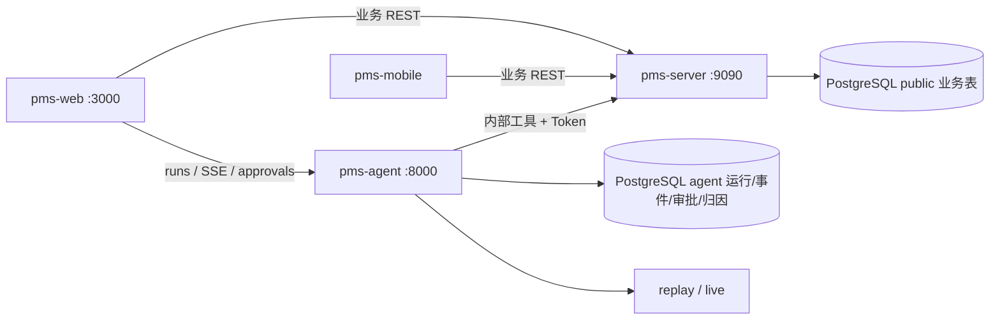
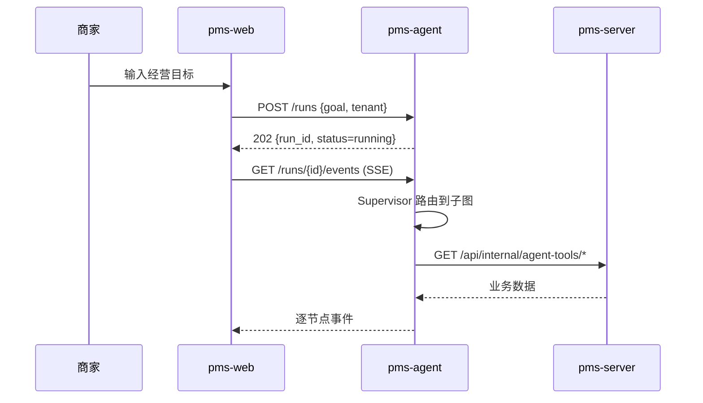
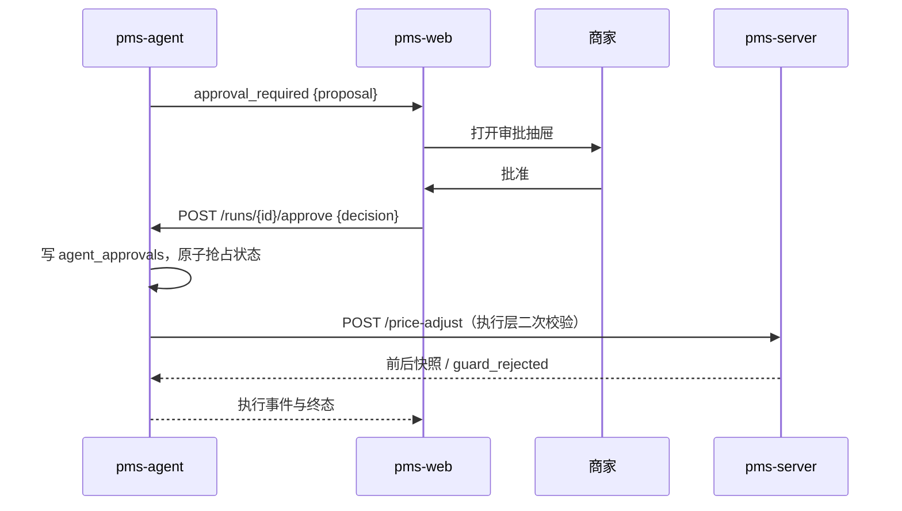

# 架构说明

本文说明 pms-ai 的服务边界、核心链路、数据模型与扩展方式。原始设计取舍见 [架构规格](design/architecture-spec.md)。

## 1. 总览

| 服务 | 职责 | 不做什么 |
| --- | --- | --- |
| `pms-server` | 业务数据唯一入口；对外 REST；Agent 内部工具端点 | 不运行 Agent 图，不做提示词编排 |
| `pms-agent` | 路由、编排、工具调用、审批中断、事件流、归因 | 不直连业务表，不绕过内部工具 |
| `pms-web` | 商家后台与协作台 UI | 不直连 Agent 数据库 |
| `pms-mobile` | 移动端业务操作与 AI 助手入口 | 不承载编排逻辑 |

## 2. 核心链路

### 2.1 创建运行

`POST /runs` 只做租户校验、插入 `agent_runs` 与后台调度，图执行异步进行，接口立即返回。前端通过 SSE 接收节点事件，同时轮询 `GET /runs/{id}` 兜底。

### 2.2 审批与执行

审批只记录「人同意了这个提案」，不直接改业务数据。执行节点调用 `pms-server` 时，服务端会重新读取资源快照，校验租户边界、幅度上限与并发版本，任一不满足即拒绝写入。

## 3. Agent 图

Supervisor 只做路由，不持有业务工具；工具白名单按子图注入。

| 子图 | 节点 | 说明 |
| --- | --- | --- |
| `revenue` | `revenue_collect` → `revenue_analyze` → `revenue_propose` → `revenue_request_approval` → `revenue_execute` | 取证、分析、提案、中断审批、执行 |
| `ops` | `ops_collect` → `ops_report` | 并发四路体检，输出 P0/P1 报告 |
| `guest` | `guest_collect` → `guest_answer` | 知识库检索；无命中或检索失败固定转人工 |
| `ota` | `ota_collect` → `ota_report` | 价差、库存、超时、同步状态 |
| 公共 | `synthesize` | 汇总只读子图的输出 |

回放模式下每个 LLM 调用按 `prompt_hash + model` 命中夹具；未命中直接抛 `FixtureMissingError`，禁止回落真实模型（见 [ADR 0003](adr/0003-replay-miss-is-failure.md)）。

## 4. 内部工具端点

统一挂载于 `/api/internal/agent-tools`，由 `internalAuthMiddleware` 校验 `X-Internal-Service-Token`，响应经 `dataMaskMiddleware` 脱敏。

| 方法 | 路径 | 用途 | 读/写 |
| --- | --- | --- | --- |
| GET | `/pricing-calendar` | 价格日历与剩余房量 | 读 |
| GET | `/occupancy` | 入住率与房态汇总 | 读 |
| GET | `/competitor-prices` | 竞对价格 | 读 |
| GET | `/channel-performance` | 渠道订单与营收 | 读 |
| GET | `/finance-summary` | 财务汇总 | 读 |
| GET | `/reviews-summary` | 评价摘要 | 读 |
| GET | `/kb-search` | 知识库检索 | 读 |
| GET | `/channel-status` | 渠道库存与同步状态 | 读 |
| GET | `/daily-revenue` | 日营收 | 读 |
| POST | `/price-adjust` | 调价落库 | 写（仅审批后调用） |

## 5. 数据模型

业务表位于 `public` schema，Agent 运行数据位于 `agent` schema（通过 `search_path` 隔离）。

| 表 | 作用 |
| --- | --- |
| `agent_runs` | 运行主记录：租户、目标、路由、状态、token 与成本 |
| `agent_events` | 节点与工具事件，SSE 与回放的数据源 |
| `agent_approvals` | 审批单：提案快照、决策、幂等键、执行结果 |
| `agent_insights` | 采纳记录与 T+7 归因回填 |
| LangGraph checkpoint | 图状态持久化，支撑中断恢复 |

事件序号单调递增，SSE 支持 `after=<seq>` 断线续传；前端因此可以逐条回放历史运行。

## 6. 安全边界

1. **租户**：运行创建受 `AGENT_ALLOWED_MERCHANTS` 白名单约束；内部工具按 `merchant_id` / `store_id` 过滤。
2. **写操作**：审批 → 执行层硬校验（±30%、资源快照、乐观并发），两道关卡缺一不可（见 [ADR 0002](adr/0002-approval-then-hard-guard.md)）。
3. **凭证**：内部调用使用独立 `INTERNAL_SERVICE_TOKEN`，不与其他 JWT 共用。

当前仍未覆盖：终端用户身份鉴权、审批幂等键唯一索引、异步连接池。详见 [安全策略](../SECURITY.md)。

## 7. 扩展方式

新增一个子图：

1. 在 `pms-agent/app/graph/` 新建子图模块，定义节点与工具白名单。
2. 在 `build.py` 注册节点与边，并在 `supervisor.py` 增加路由分支。
3. 在 `pms-server` 增加所需内部工具端点，补齐租户过滤与脱敏。
4. 在 `eval/cases/` 新建用例文件与基线，覆盖正常、缺数据与越权三类场景。
5. 更新本文的节点表与接口表。
